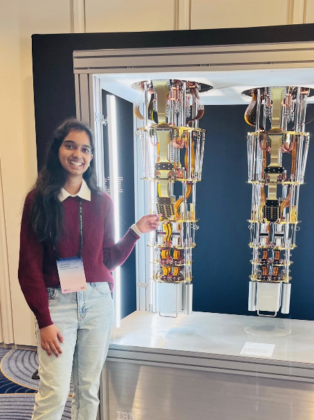

<div align="center">

# ✦ The Observatory

### **Lakshmi Siri Appalaneni**

**Building intelligent systems across agentic AI, physics-informed ML, and quantum computing.**

[](https://siriapps.github.io/)
[](https://siriapps.github.io/)
[](https://www.ibm.com/quantum/qiskit-advocate)

<br />



<br /><br />

**CS Honors @ UT Dallas** · **GPA 3.97** · **Business Intelligence & Analytics Minor**

*From research papers to production deployments — technically rigorous, actually meaningful.*

<br />

[](https://github.com/Siriapps)
[](https://linkedin.com/in/a-lakshmi-siri)
[](mailto:lakshmisiri783@gmail.com)

</div>

---

## 🔭 Tonight's Observation

> **I am curious about how agents will reshape the web** — and passionate about deep learning, quantum computing, agentic AI, algorithm design, and computer vision. I love building things that are technically rigorous *and* actually meaningful.

<table>
<tr>
<td align="center" width="25%">
<h3>15+</h3>
<sub>Projects shipped</sub>
</td>
<td align="center" width="25%">
<h3>4×</h3>
<sub>Hackathon wins</sub>
</td>
<td align="center" width="25%">
<h3>5+</h3>
<sub>Research efforts</sub>
</td>
<td align="center" width="25%">
<h3>3.97</h3>
<sub>GPA</sub>
</td>
</tr>
</table>

---

## 🏆 Highlights Reel

| 🥇 | Moment | Project / Detail |
|:---:|:---|:---|
| 🏆 | **1st Place** · HackAI Dallas 2026 | **Pondr** — adaptive learning via living knowledge graphs |
| 🏆 | **1st Place** · Yale Quantum Hackathon 2025 | **BlueQubit Challenge** |
| 🏆 | **1st Place** · ACM UTD Research Symposium | **Post-Quantum RGNN** — 30× over classical baselines |
| ⚡ | **3rd + MLH Auth0** · HackUTD 2025 · T-Mobile | **HarmoniQ** — real-time PM dashboard |
| 🥇 | **Gold · Rank 5** · ICPC AlgoQueen 2023 | Global top 5 |
| ⭐ | **Qualifier** · Indian National Olympiad in Informatics | via ZCO 2022 |
| ✨ | **Selected** · YC AI Startup School 2026 | Invite-only cohort at Chase Center |

---

## 🛰️ Featured Projects

<details open>
<summary><b>Click to explore the orbit →</b></summary>

<br />

### [Cue](https://github.com/Siriapps/cue) — *Intent-aware AI workspace agent*
Chrome extension with a multi-agent Google ADK pipeline that predicts your next five tasks and executes autonomously across Google Workspace via MCP.

`Gemini 3` · `Google ADK` · `MCP` · `TypeScript`

---

### Pondr — *1st Place · HackAI Dallas 2026*
Adaptive learning via living knowledge graphs. XGBoost fitted to the Ebbinghaus forgetting curve resurfaces decaying concepts with YouTube clips, TTS, and Calendar scheduling.

`LangChain` · `XGBoost` · `Knowledge Graphs` · `React Flow`

---

### [SafeWay](https://github.com/Siriapps/safeway) — *Safety-first navigation*
Routes by crash risk, not just speed. Two-stage hurdle model on **2.3M+** crash records · **AUC 0.891** · deployed on Cloud Run.

`CatBoost` · `SHAP` · `FastAPI` · `DuckDB` · `Cloud Run`

---

### [HarmoniQ](https://github.com/Siriapps/HarmoniQ) — *3rd Place · HackUTD*
Unified real-time dashboard: live sentiment across 100K+ posts, Prophet outage prediction, geographic heatmaps, Gemini NL insights.

`scikit-learn` · `Prophet` · `Flask` · `React` · `Auth0`

---

### [Remix](https://github.com/Siriapps/remix) — *AI mock interviews*
Semantic resume analysis, gap detection, adaptive interview flow. Cut average prep time ~40%.

`FAISS` · `LangChain` · `Gemini 2.5` · `FastAPI`

---

### [Post-Quantum RGNN](https://github.com/Siriapps/qryptik) — *1st Place · ACM Symposium*
Recurrent GNN decoder for RLCE post-quantum crypto failures. **15M+** adversarial test cases · **30×** improvement over baselines.

`PyTorch` · `NetworkX` · `Graph NNs` · `PQ Crypto`

</details>

---

## 🧠 Focus Areas

```
┌─────────────────────┬─────────────────────┬─────────────────────┐
│   Agentic AI        │  Physics-Informed   │  Quantum Computing  │
│   Multi-agent       │  ML & Digital Twins │  Qiskit · Error     │
│   orchestration     │  Surrogate models   │  correction · NISQ  │
└─────────────────────┴─────────────────────┴─────────────────────┘
```

| Stack | Tools |
|:---|:---|
| **Languages** | Python · C++ · Java · JavaScript · TypeScript · SQL · Bash |
| **ML & Research** | PyTorch · scikit-learn · XGBoost · CatBoost · Physics-Informed NNs · LSTM · SHAP · FAISS |
| **Agentic & LLM** | LangChain · Google ADK · MCP · Gemini API · RAG · Multi-Agent Orchestration |
| **Web & Infra** | FastAPI · Flask · React · Node.js · Tailwind · MongoDB · DuckDB · Cloud Run · Docker |
| **Quantum** | Qiskit · pyZX · ZX Calculus · Circuit Design · Variational Algorithms |

---

## 📡 Current Missions

| Status | Role | Organization |
|:---:|:---|:---|
| 🔜 **UPCOMING** | YC AI Startup School | Y Combinator · San Francisco |
| 🔜 **UPCOMING** | Qiskit Global Summer School 2026 | IBM Quantum |
| 🟢 **NOW** | Undergraduate AI Research Assistant | RIDE Program · UT Dallas · Dr. Yanwen Xu |
| 🟢 **NOW** | AI 301 · Open-Source Contributor | CodePath · Lance / LanceDB |
| 🟢 **NOW** | Industry Director | Google Developers Group on Campus UTD |
| 🟢 **NOW** | Qiskit Advocate | IBM Quantum |
| 🟢 **NOW** | Software Engineer | Nebula Labs · UTD |

---

## 🎖️ Certifications & Programs

<details>
<summary><b>Quantum · AI · Design · Programs (expand)</b></summary>

<br />

**Quantum**
- IBM Certified Associate Developer — Qiskit *(June 2021, age 13)*
- Qiskit Advocate · QAMP Research Mentorship *(5% acceptance)*
- QGSS 2025 · Quantum Excellence · Quantum Challenge series

**AI & Cloud**
- Engineer AI Agents with ADK — Google Cloud
- Kaggle · Coursera · Python for Everybody (UMich)

**Design**
- Adobe ACP — Graphic Design, Visual Design, Photoshop

**Programs**
- TRAIN AI Fellow *(1 of 10 from 2,000+ applicants)*
- Womanium Quantum · WISER · iQuHACK *(3× MIT)* · CodePath AI 301
- Young Member — NY Academy of Sciences · EY Expedition

</details>

---

## 🌌 About This Site

**The Observatory** is my personal portfolio — a night-sky themed experience with day/night themes, orbital project navigation, scroll-driven animations, and a workspace scene built with **React · TypeScript · Vite · Tailwind · GSAP · Three.js**.

```bash
# Run locally
npm install
npm run dev

# Deploy to siriapps.github.io (pushes built site to gh-pages branch)
npm run deploy
```

> **Note:** GitHub Pages serves from the **`gh-pages`** branch, not `main`. Pushing source to `main` alone won't update the live site — run `npm run deploy` after changes.

---

<div align="center">

### *The dome is always open.*

**[→ Visit the live site](https://siriapps.github.io/)** · **[→ View on GitHub](https://github.com/Siriapps/SiriApps.github.io)**

<br />

<sub>Built with curiosity, rigor, and a lot of late-night observations ✦</sub>

</div>
